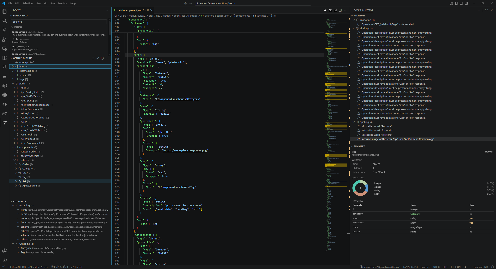

# DocKit: OpenAPI Documentation Toolkit for Visual Studio Code

The DocKit extension transforms VS Code into a dedicated OpenAPI documentation editor. It streamlines the workflow for navigating, editing, and validating large OpenAPI (3.x) and Swagger (2.x) specification files using a native, dual-sidebar interface.

> **Note:** DocKit is currently in preview (v0.1.1) for feedback and suggestions (see [Feedback and Support](#feedback-and-support)).

## 📋 Requirements & Installation

*   Visual Studio Code **1.118.0** or later. No additional runtime requirements—validation, linting, and spell checking all run locally and offline.
*   Install from the VS Code Marketplace (search for "DocKit"), or run this command in your terminal: 
  `code --install-extension dockit.oas-docs`.

## 🎯 Who is this for?

DocKit is designed for technical writers, developers, and product managers who work with OpenAPI specifications and value high-quality, consistent, and error-free documentation.

## 🚀 Key Features

DocKit enhances the native VS Code experience with two dedicated sidebars, **DocKit** and **DocKit: Inspector**, which provide specialized views and tools for OpenAPI development.

### The DocKit Sidebar (Primary Sidebar)

This is your main navigation and editing hub.

*   **Search & Go view:** A powerful search that live-filters your entire spec by keys and values. Clicking a result instantly navigates you to its location in the editor and updates the Inspector.
*   **OpenAPI Outline view:** More than just a file tree, this is an intelligent, OpenAPI-aware outline of your specification.
    *   **Two-Way Sync:** The outline stays synchronized with your cursor position in the editor, and clicking a node in the tree scrolls the editor to the corresponding line.
    *   **Leaf Editing:** The signature DocKit interaction. Hover over a scalar value (like a `summary` or `description`) in the outline and click the **✎ (Edit)** icon to make quick, inline changes. This is perfect for fixing typos without hunting through the file.
*   **References view:** Easily trace `$ref` pointers. See all incoming and outgoing references for a selected schema or component to understand its dependencies and usage across the spec.

### The DocKit: Inspector Sidebar (Secondary Sidebar)

This sidebar provides deep, contextual information about the currently selected node in your OpenAPI file.

*   **All Issues view:** See a focused list of validation, linting, and prose issues for the selected node, allowing you to quickly address problems in context.
*   **Summary view:** Get a visual summary of the selected node, including a type-distribution donut chart for objects and a summary of properties.

### Integrated Toolchain & Validation

DocKit bundles a powerful set of commands, accessible from the Command Palette (`Ctrl+Shift+P`), to ensure your API specifications are robust and professional.

*   **Real-time Validation:** Get instant feedback on schema compliance for both OpenAPI 3.x and Swagger 2.x, powered by `@scalar/openapi-parser`. Errors are highlighted in the editor and listed in the **Problems** panel and **All Issues** view.
*   **API Linting:** Enforce style guides and best practices using the integrated `@stoplight/spectral-core` engine.
*   **Spell & Prose Checking:** DocKit treats your documentation as first-class content. It uses `@textlint/kernel` to check for spelling and style issues in your `description` and `summary` fields, with quick-fix suggestions.
*   **Format Conversion:** Convert specs between JSON and YAML with **`DocKit: Convert OAS (JSON ↔ YAML)`**.
*   **Code Snippet Generation:** Generate request snippets for your operations with **`DocKit: Generate Code Snippets`**, powered by `@scalar/snippetz`. Currently, only `curl` commands are generated.

### Command Reference

All commands are available from the Command Palette (`Ctrl+Shift+P`):

| Command | Description |
| :--- | :--- |
| `DocKit: Validate OpenAPI Document` | Validate the active spec against the OpenAPI 3.x or Swagger 2.x schema. |
| `DocKit: Lint OAS File` | Run Spectral linting with the bundled rulesets. |
| `DocKit: Check Spelling` | Spell- and prose-check `description`/`summary` fields. |
| `DocKit: Convert OAS (JSON ↔ YAML)` | Convert the active spec between JSON and YAML. |
| `DocKit: Generate Code Snippets` | Generate request code snippets for operations. |
| `DocKit: Show DocKit` / `Show DocKit Inspector` | Reveal the DocKit sidebars. |
| `DocKit: Follow Cursor` / `Filter on Type` / `Sort By: …` | Toggle OpenAPI Outline behavior. |

## 🛠️ Getting Started

**NOTE**: For the best experience, use DocKit's recommended dual-sidebar layout. 

After you install DocKit, follow these steps:

1.  Click the **DocKit** icon in the VS Code Activity Bar to open the primary sidebar.
2.  Open the Secondary Side Bar by running **`View: Toggle Secondary Side Bar`** from the Command Palette (`Ctrl+Shift+P`).
3.  Open the **DocKit: Inspector** view container.  
4.  As the **DocKit: Inspector** opens in the primary sidebar by default, you need to manually move (drag) it to the secondary sidebar once. VS Code will remember this layout thereafter. 
5.  Open an OpenAPI (3.x) or Swagger (2.x) specification file (`.json`, `.jsonc`, `.yaml`, or `.yml`). The extension includes the petstore sample OAS files (JSON and YAML formats) in the `samples` folder. You can use these for a quick start.

### How to Use the DocKit Sidebars

*   **Navigate:** Use the **OpenAPI Outline** or **Search & Go** in the primary sidebar to move through your spec. As you select different nodes, the editor will follow, and the **DocKit: Inspector** will update to show contextual information.
*   **Edit:** Make quick corrections to descriptions, summaries, and other scalar values directly from the **OpenAPI Outline** using the inline **✎ (Edit)** action.
*   **Audit & Validate:** Run commands like **`DocKit: Validate OpenAPI Document`**, **`DocKit: Lint OAS File`**, and `DocKit: Check Spelling` from the Command Palette. All findings will appear in the VS Code **Problems** panel and are grouped contextually in the **All Issues** view within the Inspector sidebar.
*   **Trace Dependencies:** Select a schema and use the **References** view to see where it's used and what it depends on.

## ⚙️ Extension Settings

DocKit provides several settings to customize your experience. You can modify these in your VS Code User or Workspace Settings (`Preferences: Open Settings (UI)`).

| Setting | Default | Description |
| :--- | :--- | :--- |
| `dockit.validateOnSave` | `true` | Run OpenAPI validation when a spec file is saved. |
| `dockit.showValuePreviews` | `true` | Show scalar value previews next to tree nodes in the outline. |
| `dockit.followCursor` | `false` | Automatically reveal the node currently selected in the text editor in the OpenAPI Outline. |
| `dockit.filterOnType` | `true` | Enable typing to filter the OpenAPI Outline. |
| `dockit.outlineSortOrder` | `"position"` | Determine how the OpenAPI Outline should be sorted. Valid options are `"position"`, `"name"`, or `"category"`. |

## ⚖️ Open Source Technologies & Attributions

DocKit is made possible by the incredible work of the open-source community. I would like to specifically acknowledge and express my gratitude to the maintainers and contributors behind **Stoplight Spectral**, **Scalar**, and **Textlint**. Their dedication to building robust, high-quality tools provides the foundation for DocKit's core capabilities.

*   **Stoplight Spectral Ecosystem:** Powers real-time API governance, syntax checking, and linting rulesets to keep specifications compliant with industry standards.
*   **Scalar OpenAPI Tools:** Drives the specification parsing, validation, and code snippet generation.
*   **OpenAPI Specification Schema:** Bundled for offline native VS Code JSON/YAML validation and autocomplete.
*   **Textlint Kernel:** Operates under the hood to execute technical prose and spelling validation across your documentation fields.
*   Other foundational permissive libraries (e.g., `ajv`, `jsonc-parser`, `yaml`).
*   **Spell-check word lists:** The bundled dictionary is consolidated from SCOWL (via `wooorm/dictionaries`), `dwyl/english-words`, `cspell-dicts` software terms, and `textlint-rule-terminology` data.

While the specific VS Code extension UI and the integration code tying these tools together are proprietary (see `LICENSE.txt`), all bundled third-party open-source software is subject to its own respective copyright notices and open-source licenses. For a comprehensive list of all bundled dependencies, transitive libraries, and required legal notice texts and open-source licenses, please consult the `THIRD_PARTY_NOTICES.txt` file included with this extension distribution.

## ⚠️ Known Limitations

*   Very large specs (5+ MB) may take a few seconds for the initial outline build and lint pass; linting runs in a background worker so the editor stays responsive.
*   Code snippet generation works for OpenAPI version 3.x files only. 

## 💬 Feedback and Support

Your input directly shapes DocKit's roadmap.

*   Found a bug or have a feature request? [Open an issue on GitHub](https://github.com/techwritetools/dockit-oasdocs/issues/new)
*   Direct support: [Manu Kumar](mailto:manukumar_26@outlook.com).
*   LinkedIn: [Manu Kumar](https://www.linkedin.com/in/manukumar1729/)

*Enjoy a cleaner, faster, and more native API design experience!*
