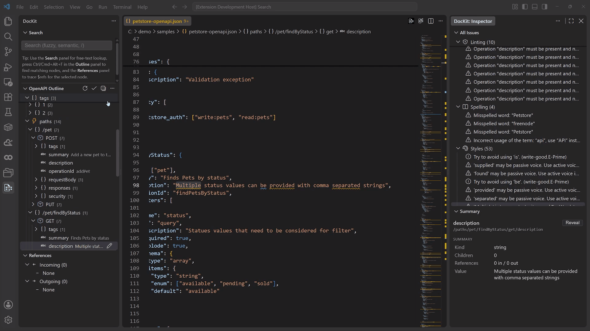

# DocKit: OpenAPI Documentation Toolkit for Visual Studio Code

DocKit is a Visual Studio Code extension for reviewing and improving
OpenAPI specifications. It helps technical writers navigate large
specifications, edit documentation fields, identify structural and prose
issues, and prepare a copy of a specification for publication.



## Requirements and installation

-   Visual Studio Code **1.118.0** or later.
-   No additional runtime requirements. Validation, linting, spelling,
    and style checks run locally and offline.

Install DocKit from the VS Code Marketplace by searching for **DocKit**,
or install it from a terminal:

``` text
code --install-extension dockit.oas-docs
```

## Who is DocKit for?

DocKit is primarily intended for **technical writers who edit existing
OpenAPI specifications**. It can also help developers, API architects,
product managers, and API owners review and maintain those
specifications.

## Documentation

See the [DocKit User
Guide](https://techwritingtools.gitbook.io/dockit/documentation) for
detailed instructions on reviewing, editing, validating, linting, and
preparing OpenAPI specifications.

## Supported specifications and file formats

DocKit recognizes the following OpenAPI specifications:

-   OpenAPI 3.1.0--3.1.2
-   OpenAPI 3.0.0--3.0.4
-   OpenAPI 2.0 (Swagger 2.0)

Supported file extensions are `.json`, `.jsonc`, `.yaml`, and `.yml`.

## Features

### Review a specification

DocKit provides two sidebars that work alongside the VS Code editor:

-   **DocKit** (primary sidebar) provides navigation and editing tools.
-   **DocKit: Inspector** (secondary sidebar) provides contextual
    information and diagnostics.

#### OpenAPI Outline

The **OpenAPI Outline** displays the structure of the active
specification. Select a node to navigate to its location in the editor.

You can also:

-   follow the editor cursor in the Outline;
-   filter the Outline as you type;
-   sort nodes by position, name, or category;
-   group endpoints by tag.

#### Search

**Search** searches keys, paths, and scalar values in the active
specification. Select a result to navigate directly to its location in
the editor and update the Inspector.

#### References

The **References** view shows incoming and outgoing `$ref` relationships
for a selected schema or component. Use it to trace where a reusable
component is used and which other components it references.

#### Inspector

The **DocKit: Inspector** provides information about the selected node.

-   **Summary** shows information about the selected node, including
    property counts, child counts, and reference counts. For objects, it
    also shows the distribution of property value types.
-   **All Issues** groups validation, linting, spelling, and style
    findings so you can review problems in context.

### Edit documentation

#### Leaf editing

Use the **✎ (Edit)** action in the OpenAPI Outline to edit scalar values
such as `summary` and `description` without locating the corresponding
text manually in the source file.

Leaf editing supports scalar values such as strings, numbers, and
booleans. Structural changes, such as adding or removing objects or
properties, are made in the source editor.

### Check specification quality

#### Validation

DocKit provides version-aware validation for supported OpenAPI
specifications. JSON editor validation and autocomplete use the schema
corresponding to the specification's declared version. DocKit's own
structural validation checks both JSON and YAML specifications.

Validation findings appear in the editor, the VS Code **Problems**
panel, and the Inspector's **All Issues** view.

#### API linting

API linting is **off by default** and is enabled explicitly in VS Code
Settings. You choose the individual rules that DocKit runs.

DocKit includes the built-in `spectral:oas` rules and **19 optional
DocKit governance rules** covering areas such as URL conventions,
naming, security, developer experience, and lifecycle metadata.

Use **`DocKit: Open Rules Reference`** to view the available rules,
their descriptions, and their current status.

#### Spelling and terminology

DocKit checks spelling and terminology in documentation-oriented fields
such as `description` and `summary`. Spelling and terminology checks are
enabled by default.

You can add product names, domain terms, and other words to the built-in
dictionary through VS Code Settings. You can also provide up to two
custom dictionary files.

#### Prose style checks

DocKit provides optional style checks for `description` and `summary`
prose. The available style sets are:

-   Google
-   Microsoft
-   IBM
-   write-good
-   alex

Each style is **off by default** and can be enabled independently. Style
findings appear separately from spelling findings in the Inspector.

### Prepare a public specification

**Export Public Spec** creates a copy of the active specification with
operations or paths marked by the configured internal vendor extension
removed. The source specification is not modified.

By default, the internal marker is `x-internal`. Optional component
pruning can remove components that are proven to be unreachable after
internal operations are removed.

**Review the exported specification before publishing it.**

Run **`DocKit: Export Public Spec (Remove Internal Endpoints)`** from
the Command Palette.

### Additional tools

-   **JSON/YAML conversion:** Use
    **`DocKit: Convert OAS (JSON ↔ YAML)`** to create a converted copy
    of the active specification. The source file is not modified.
-   **Code snippets:** Use **`DocKit: Generate Code Snippets`** to
    generate cURL and Python (`requests`) request snippets for
    operations. Code snippet generation supports OpenAPI 3.x only.

## Getting started

After installing DocKit:

1.  Click the **DocKit** icon in the VS Code Activity Bar.
2.  Open the Secondary Side Bar by running
    **`View: Toggle Secondary Side Bar`** from the Command Palette
    (`Ctrl+Shift+P`).
3.  Open the **DocKit: Inspector** view.
4.  If the Inspector opens in the primary sidebar, drag its view
    container to the Secondary Side Bar. VS Code remembers the layout.
5.  Open an OpenAPI specification file.

For a recommended review workflow, see the [User
Guide](https://techwritingtools.gitbook.io/dockit/documentation).

## Commands

All DocKit commands are available from the VS Code Command Palette
(`Ctrl+Shift+P`).

| Command | Description |
| :--- | :--- |
| `DocKit: Validate OpenAPI Document` | Validate the active OpenAPI specification. |
| `DocKit: Lint OAS File` | Run the linting rules selected in `dockit.linting.enabledRules`. |
| `DocKit: Open Rules Reference` | Open the catalog of available linting rules and styles, with descriptions and current status. |
| `DocKit: Check Spelling` | Check spelling and terminology, and run enabled style checks, in supported documentation fields. |
| `DocKit: Export Public Spec (Remove Internal Endpoints)` | Create a copy with internal operations or paths removed; the source is not modified. |
| `DocKit: Convert OAS (JSON ↔ YAML)` | Convert the active specification between JSON and YAML. |
| `DocKit: Generate Code Snippets` | Generate cURL and Python (`requests`) snippets for operations. |
| `DocKit: Show DocKit` / `Show DocKit Inspector` | Open the DocKit sidebars. |
| `DocKit: Follow Cursor` / `Filter on Type` / `Sort By: …` / `Group by Tag` | Change OpenAPI Outline behavior. |

## Configuration

DocKit settings are available in **VS Code Settings**
(`Preferences: Open Settings (UI)`). Search for `dockit`.

| Setting | Default | Description |
| :--- | :--- | :--- |
| `dockit.validateOnSave` | `true` | Validate the specification when it is saved. |
| `dockit.showValuePreviews` | `true` | Show scalar value previews next to Outline nodes. |
| `dockit.followCursor` | `false` | Reveal the node corresponding to the editor cursor in the Outline. |
| `dockit.filterOnType` | `true` | Filter the Outline as you type. |
| `dockit.outlineSortOrder` | `"position"` | Sort the Outline by `position`, `name`, or `category`. |
| `dockit.outlineGroupBy` | `"none"` | Group endpoints by tag when set to `"tag"`. |
| `dockit.linting.enabled` | `false` | Enable API linting. |
| `dockit.linting.enabledRules` | `[]` | Select the individual linting rules to run. |
| `dockit.spellCheck.styles.google` | `false` | Enable Google style checks. |
| `dockit.spellCheck.styles.microsoft` | `false` | Enable Microsoft style checks. |
| `dockit.spellCheck.styles.ibm` | `false` | Enable IBM style checks. |
| `dockit.spellCheck.styles.writeGood` | `false` | Enable write-good readability checks. |
| `dockit.spellCheck.styles.alex` | `false` | Enable alex inclusive-language checks. |
| `dockit.spellCheck.words` | `[]` | Add words that the spell checker should accept. |
| `dockit.spellCheck.customDictionaries` | `[]` | Specify custom `.txt` or `.json` dictionary files. |
| `dockit.publicExport.internalExtension` | `"x-internal"` | Specify the vendor extension that marks internal operations or paths. |
| `dockit.publicExport.stripInternalMarker` | `true` | Remove the internal marker from surviving operations in the exported copy. |
| `dockit.publicExport.pruneUnusedComponents` | `false` | Remove components proven to be unreachable after internal operations are removed. |

For custom dictionary formats, security restrictions, linting rules,
style checks, and the complete configuration reference, see the [User
Guide](https://techwritingtools.gitbook.io/dockit/documentation).

## Known limitations

-   Very large specifications (5 MB or larger) may take a few seconds to
    build the initial Outline and lint pass. Linting runs in a
    background worker so that the editor remains responsive.
-   Code snippet generation supports OpenAPI 3.x only.

## Open-source technologies and attributions

DocKit incorporates the following open-source technologies and data:

-   **Stoplight Spectral** for API linting.
-   **Scalar OpenAPI tools** for specification parsing, validation, and
    code snippet generation.
-   **OpenAPI Specification schemas** for version-aware JSON validation
    and autocomplete.
-   **Textlint Kernel** for spelling and terminology checks.
-   Other libraries, including `ajv`, `jsonc-parser`, and `yaml`.
-   **Spell-check word lists** from SCOWL (via `dictionary-en`),
    `@cspell/dict-software-terms`, `textlint-rule-terminology`, and
    DocKit's REST/OpenAPI term lists.
-   **Prose style rules** adapted from the Vale community style sets:
    write-good, alex, Google, Microsoft, and IBM.

The DocKit extension UI and integration code are proprietary.
Third-party software remains subject to its respective licenses and
copyright notices. See `THIRD_PARTY_NOTICES.txt` in the extension
distribution for the complete list of bundled dependencies and required
notices.

## Feedback and support

-   Documentation: [DocKit User
    Guide](https://techwritingtools.gitbook.io/dockit/documentation)
-   Bugs and feature requests: [GitHub
    issues](https://github.com/techwritetools/dockit-oasdocs/issues/new)
-   Direct support: [Manu Kumar](mailto:manukumar_26@outlook.com)
-   [LinkedIn](https://www.linkedin.com/in/manukumar1729/)
