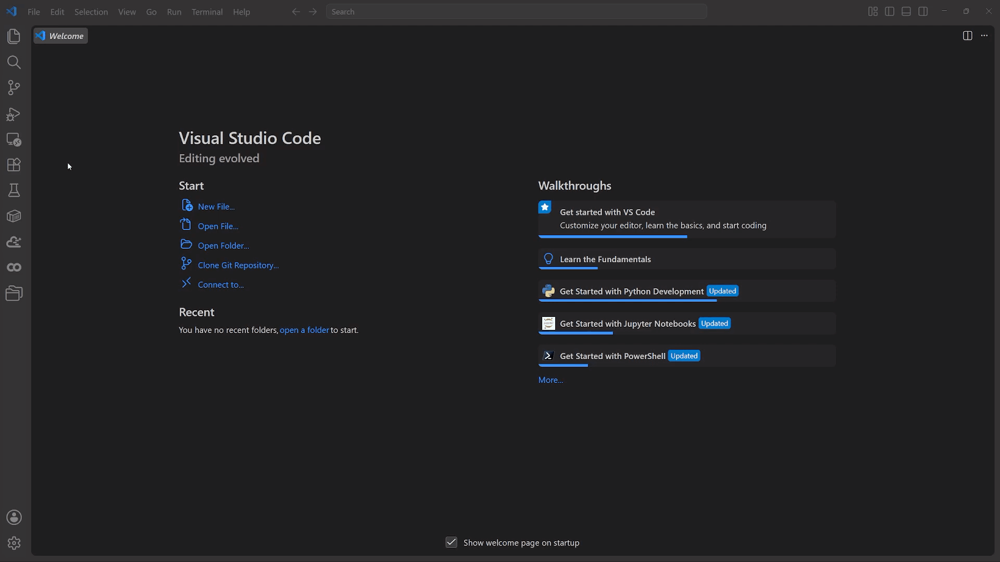
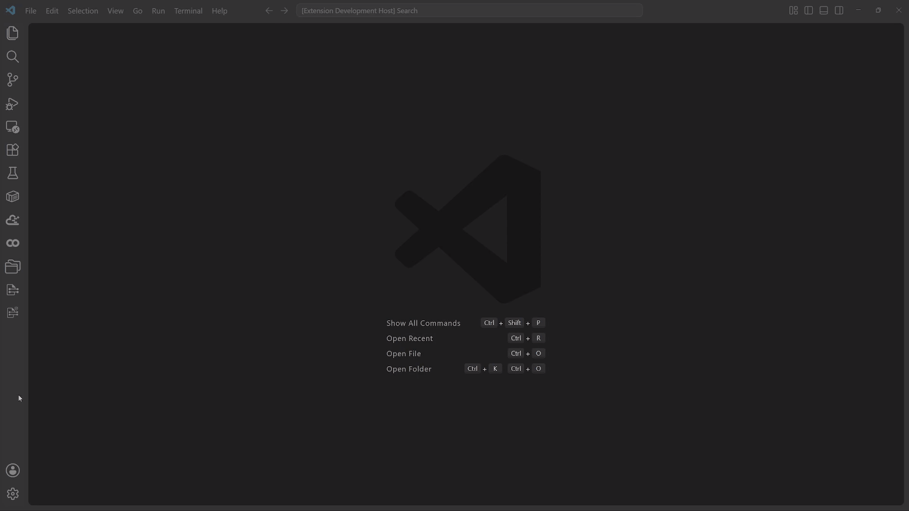
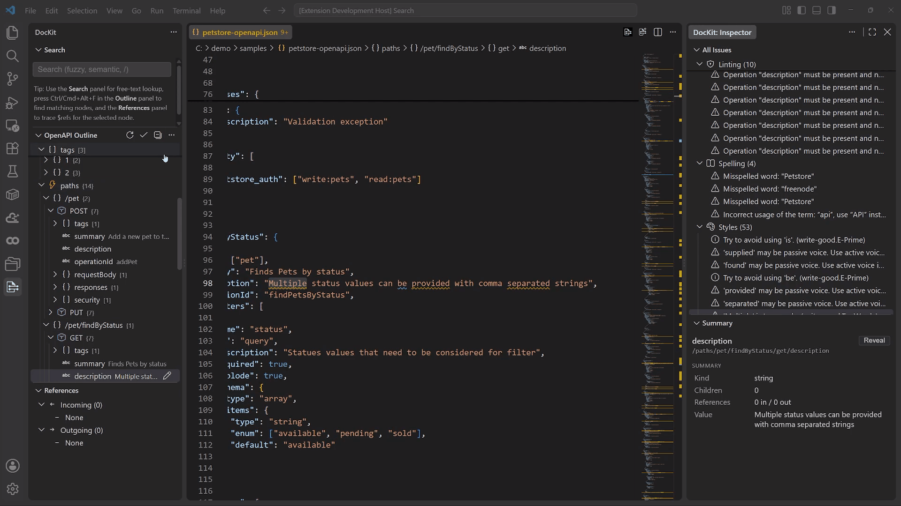
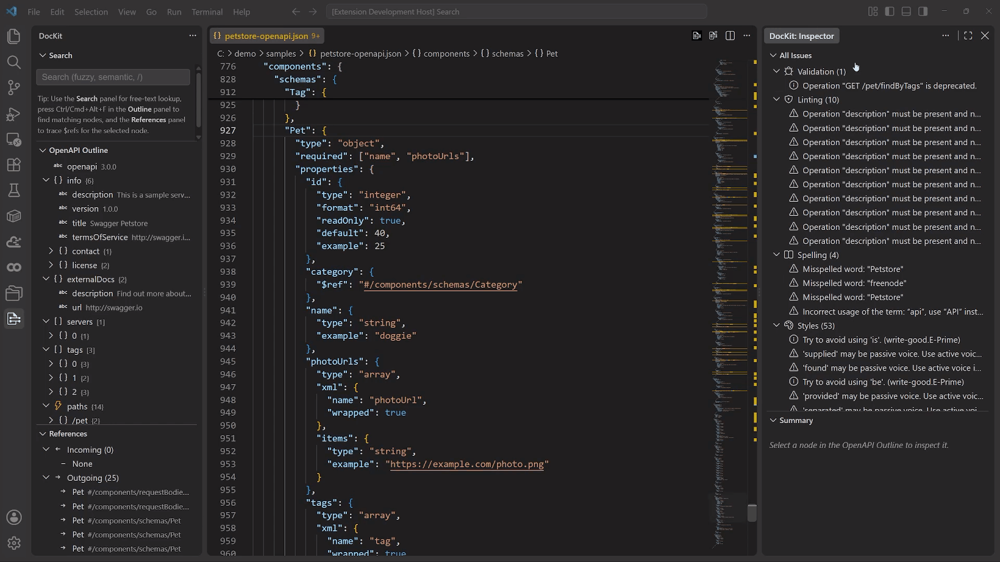
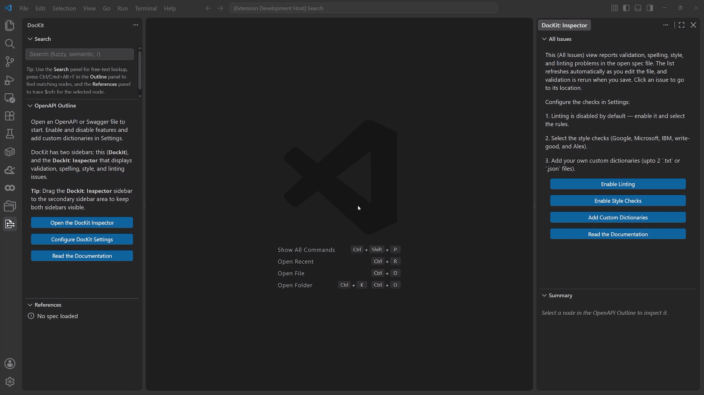
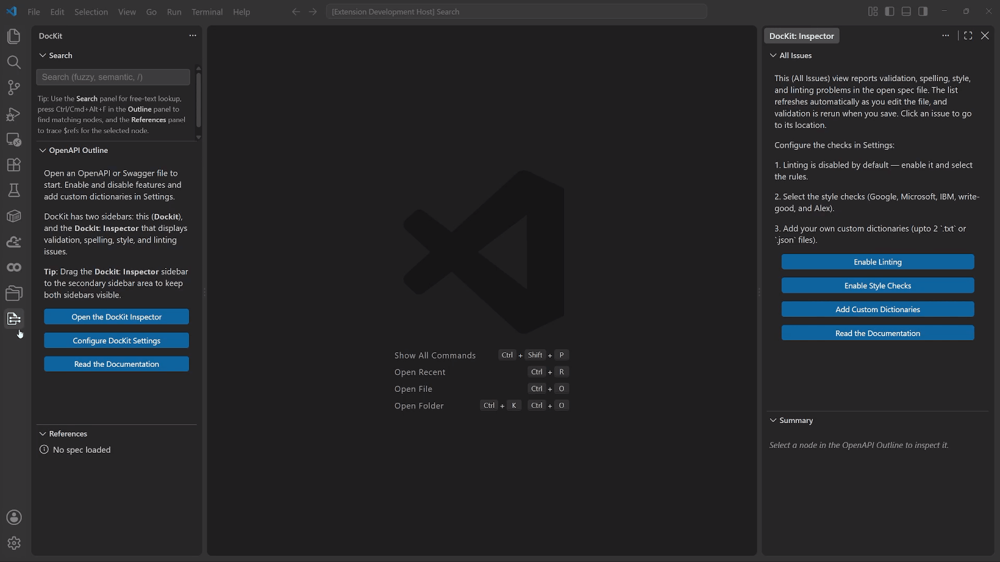

# DocKit User Guide

Welcome to the User Guide for **DocKit: OpenAPI Documentation Toolkit**. Whether you’re a technical writer, API architect, developer, or product manager, this guide shows you how the DocKit extension can help you manage your OpenAPI 2.0 and 3.x specifications efficiently in Visual Studio Code.

## 1. Welcome & Overview

### What is DocKit?

**DocKit** turns Visual Studio Code into a high-performance, native API documentation studio. Designed specifically for docs-as-code workflows, DocKit eliminates the friction of editing multi-thousand-line JSON and YAML OpenAPI specifications. It provides a non-blocking dual-sidebar UI, version-aware validation, prose spelling/terminology checking, optional Vale-based style checks (Google, Microsoft, IBM, write-good, Alex), an opt-in Spectral + custom governance linting engine, leaf-level inline editing, $ref dependency tracing, and automated public spec exporting.

### Supported Specifications & File Formats

DocKit automatically recognizes and parses open files matching any of the following formats:

* **OpenAPI 3.1.x** (3.1.0 – 3.1.2; .json, .jsonc, .yaml, .yml)
* **OpenAPI 3.0.x** (3.0.0 – 3.0.4; .json, .jsonc, .yaml, .yml)
* **Swagger 2.0** (.json, .jsonc, .yaml, .yml)

### Key Persona Benefits

* **Technical Writers:** Edit prose summaries and descriptions without touching raw code or breaking YAML spacing. Catch passive voice, wordiness, typos, and style-guide violations directly in the editor.
* **Developers & API Architects:** Avoid false-positive schema errors, enforce REST URL and schema naming standards before PR review, explore two-way $ref dependency graphs, and generate cURL/Python snippets.
* **Product Managers & API Owners:** Audit spec completeness with visual donut charts and safely export public-ready specs with automatic x-internal endpoint stripping and optional component pruning.

## 2. Installation & Workspace Setup

<figure><figcaption></figcaption></figure>

### 2.1 Installation



#### Launch Visual Studio Code

Launch **Visual Studio Code** (**v1.118.0 or higher required**).



#### Open the Extensions View

Click the Extensions icon on the Activity Bar or press Ctrl+Shift+X (Cmd+Shift+X on macOS).



#### Search for DocKit

Search for DocKit or extension ID `dockit.oas-docs`.



#### Install the extension

Click **Install**.



Alternatively, install via the terminal command line:

```bash
code --install-extension dockit.oas-docs
```

### 2.2 Configuring the Dual-Sidebar Workspace Layout

To maximize productivity, DocKit is engineered for a **3-pane dual-sidebar layout** (Primary Sidebar on the left, Code Editor in the center, Inspector Sidebar on the right).

<figure><figcaption></figcaption></figure>

**First-Time Setup Step (One-Time Action):** When first installed, VS Code places all new view containers in the Primary Sidebar by default.



#### Locate the Inspector container

Look at the Primary Sidebar (left side) and locate the **DocKit: Inspector** container icon.



#### Move the Inspector container

**Click and drag** the **DocKit: Inspector** icon over to VS Code's **Secondary Sidebar** (right side).

If the Secondary Sidebar is hidden, press Ctrl+Alt+B or Cmd+Alt+B to reveal it.



#### Use the 3-pane workspace

Your workspace now has:

* **Left (Primary Sidebar):** DocKit (Search & Go, OpenAPI Outline, References).
* **Center:** Main Code Editor (JSON / YAML source file).
* **Right (Secondary Sidebar):** DocKit: Inspector (Summary + All Issues diagnostics).



<table><thead><tr><th>PRIMARY SIDEBAR</th><th>CENTER CODE EDITOR</th><th>SECONDARY SIDEBAR</th></tr></thead><tbody><tr><td>(DocKit)</td><td></td><td>(DocKit: Inspector)</td></tr><tr><td>🔍 Search &#x26; Go</td><td><pre class="language-json"><code class="lang-json">(Example)
<strong>  paths:
</strong>    /pets:
      get:
        summary: List pets
</code></pre></td><td>📊 Summary</td></tr><tr><td>🌳 OpenAPI Outline</td><td></td><td>- Donut Chart</td></tr><tr><td>🔗 References ($ref)</td><td></td><td>⚠️ All Issues</td></tr><tr><td></td><td></td><td>- Validation/Style</td></tr></tbody></table>

### 2.3 Activating DocKit

DocKit activates automatically whenever you open a `.json`, `.jsonc`, `.yaml`, or `.yml` file. Its OpenAPI features engage once the document has a top-level `openapi` or `swagger` property.

## 3. Navigating API Specifications

<figure><figcaption></figcaption></figure>

### 3.1 OpenAPI Outline View

The **OpenAPI Outline** (Primary Sidebar → DocKit → OpenAPI Outline) displays a version-aware visual tree representing the structure of your specification.

#### Tree Elements & Icons

* 🌐 **Root Metadata:** Document title, version, and server URLs.
* 📦 **Paths & Endpoints:** Paths (e.g. `/users/{id}`) and HTTP operation nodes (GET, POST, PUT, DELETE, PATCH).
* 📝 **Parameters & Responses:** Path/operation parameters, status codes (200, 400, 500), and response schemas.
* 🧩 **Components / Definitions:** Reusable schemas, security schemes, headers, and request bodies.

#### Two-Way Cursor Synchronization

* **Tree ➔ Editor:** Click any node in the tree to scroll the code editor to the exact line of that element.
* **Editor ➔ Tree:** Move your cursor in the text editor and DocKit highlights and reveals the corresponding node in the Outline — enable this with the **Follow Cursor** toggle (`dockit.followCursor`, off by default).

#### Toolbar Actions

Top-right of Outline View, under the ⋯ menu:

* **Follow Cursor** (`dockit.outline.toggleFollowCursor`): Sync the tree to the editor cursor.
* **Filter on Type** (`dockit.outline.toggleFilterOnType`): Type-to-filter the tree.
* **Sort By: Position / Name / Category** (`dockit.outline.sortByPosition`, …sortByName, …sortByCategory): Choose tree sort order — Position (document order, default), Name (alphabetical), or Category (by node type).
* **Group by Tag** (`dockit.outline.toggleGroupByTag`): Reorganize endpoints under their global tags (e.g. pet, store, user); the chosen sort order still applies within each tag group.
* **Refresh** (`dockit.refresh`): Re-parse and refresh the tree.

### 3.2 Search & Go View

For large monolithic specifications, standard text search can be sluggish.



#### Open Search & Go

Open Primary Sidebar → DocKit → **Search & Go**.



#### Enter a search term

Type any search term into the input box, such as `PetNotFound` or `bearerAuth`.



#### Review live-filtered results

Results filter live as you type, indexing keys, paths, and scalar values.



#### Navigate to a result

Click any result item to jump directly to the target line in the editor and update the Inspector.



### 3.3 References View ($ref Dependency Explorer)

When refactoring shared schemas in `components/schemas`, knowing where models are used is crucial to avoid breaking changes.



#### Select a schema

Select any schema node in the editor or Outline tree.



#### Open References

Open Primary Sidebar → DocKit → **References**.



#### View dependencies

View two dependency lists:

* **Incoming References:** Every operation, parameter, or response referencing this schema.
* **Outgoing References:** Child schemas referenced by this model.



#### Navigate to a definition

Click any node in the reference tree to navigate to its definition.



## 4. Editing & Authoring Capabilities

### 4.1 Leaf Editing (Inline Scalar Tree Modification)

Leaf Editing allows you to update documentation prose, summaries, enum choices, and boolean flags directly from the OpenAPI Outline without searching through raw code or breaking YAML indentation.



#### Hover over a scalar node

Hover over a scalar node in the Outline tree, such as `"summary"`.



#### Open the editor

Click the ✎ (Edit Pencil Icon) that appears on hover.



#### Update the value

A VS Code native input prompt or dropdown opens:

* Text fields (`summary`, `description`) → Free-form input prompt.
* Booleans (`deprecated`) → Quick Pick dropdown menu.



#### Confirm changes

Type changes and press Enter.



#### Review the source update

Source code updates cleanly as an undoable (Ctrl+Z) workspace edit.




**Note on Scope:** Leaf Editing is designed for **scalar values** (strings, numbers, booleans). Structural modifications (such as adding new path objects, creating new schema keys, or deleting entire blocks) are performed directly in the text editor.


### 4.2 Format Converter (JSON ↔ YAML)

DocKit provides bi-directional conversion between JSON and YAML specification formats.

#### How to Convert Formats



#### Open the specification

Open the OpenAPI specification file (`.json` or `.yaml`).



#### Open the Command Palette

Open the Command Palette (Ctrl+Shift+P / Cmd+Shift+P).



#### Run the conversion command

Run command: **DocKit: Convert OAS (JSON ↔ YAML)**.



#### Open the converted result

The converted result opens in a new editor tab beside the source. The original file is not modified.



## 5. Inspector & Diagnostic Panels

The **DocKit: Inspector** container (in the Secondary Sidebar) provides visual feedback during editing.

<figure><figcaption></figcaption></figure>

### 5.1 Summary View (Visual Donut Chart)

* **Donut Chart:** Displays object property type distribution (strings, numbers, booleans, objects, arrays) for the selected OpenAPI node.
* **Property Breakdown:** Summarizes property counts, child counts, and incoming/outgoing reference counts for the selected node.

### 5.2 All Issues View (Grouped Diagnostics)

Consolidates all file diagnostics, grouped by source into these categories:

1. **Validation:** Schema compliance errors (@scalar/openapi-parser).
2. **Linting:** Spectral and custom `dockit-*` governance violations.
3. **Spelling:** Spelling and terminology issues.
4. **Styles:** Vale style-guide findings (Google/Microsoft/IBM/write-good/alex).

You can switch the grouping between **by source** and **by path** from the view's menu. Clicking any issue item navigates the code editor to the exact location.

## 6. Quality, Validation & Governance

### 6.1 Version-Aware Schema Validation

Out of the box, VS Code would validate every OpenAPI JSON file against a single schema, flagging valid OpenAPI 3.0 or Swagger 2.0 files with false-positive "property not allowed" errors.

DocKit fixes this with **version-aware editor validation**:

* A bundled routing JSON Schema inspects the declared version (`swagger: "2.0"`, `openapi: "3.0.x"`, `openapi: "3.1.x"`) and applies the matching bundled schema — so 3.0 documents are checked against the 3.0 schema, not 3.1. This powers the editor's inline schema validation and autocomplete for **JSON** specs.
* Separately, DocKit's own structural validation (**@scalar/openapi-parser**) checks both JSON and YAML and surfaces findings under the **Validation** group in the Inspector. It runs on open/edit (debounced) and on save (`dockit.validateOnSave`).

### 6.2 Opt-In API Governance Engine (Spectral + 19 Custom dockit-\* Rules)

DocKit bundles the @stoplight/spectral-core engine with the built-in `spectral:oas` ruleset (56 rules) plus **19 custom DocKit governance rules** (`dockit-*`). Linting is **opt-in and fully off by default.**

#### Enabling Linting



#### Open VS Code Settings

Open VS Code Settings (Ctrl+,).



#### Enable linting

Enable **dockit.linting.enabled**.



#### Add rule IDs

Add the rule IDs you want to **dockit.linting.enabledRules**.

This is an **allowlist that defaults to empty** — with the master on but the list empty, **no linting findings are produced**. The Settings editor shows a dropdown of every available rule (with descriptions) to pick from.



#### Key Custom Governance Rules (dockit-\*)

| **Rule ID**                                 | **Severity** | **Description / Requirement**                                     |
| ------------------------------------------- | ------------ | ----------------------------------------------------------------- |
| dockit-paths-kebab-case                     | Error        | URL path segments must be kebab-case (/user-profiles).            |
| dockit-no-crud-verbs-in-paths               | Error        | Paths must not contain CRUD verbs (e.g. /getUsers, /createOrder). |
| dockit-path-contains-version                | Error        | Paths must include a major version prefix (e.g. /v1/users).       |
| dockit-no-numeric-ids-in-paths              | Error        | Paths must use template parameters, not hardcoded numeric IDs.    |
| dockit-schema-names-pascal-case             | Error        | Component schema names must use PascalCase (UserProfile).         |
| dockit-property-camel-case                  | Error        | Schema property names must use camelCase (firstName).             |
| dockit-require-servers-https                | Error        | Server URLs must use https://.                                    |
| dockit-no-http-basic-auth                   | Error        | Prohibits HTTP Basic auth; use OAuth2 or Bearer.                  |
| dockit-define-error-response-400            | Error        | Operations must define a 400 response.                            |
| dockit-require-rate-limit-headers           | Warning      | 2xx/4xx responses should declare IETF RateLimit-\* headers.       |
| dockit-deprecated-operation-has-description | Error        | Deprecated operations must document a migration path.             |

_This is a representative subset. Run **DocKit: Open Rules Reference** for the complete list of all 75 rules — 56 built-in + 19 custom._

### 6.3 Interactive Rules Reference Catalog

To inspect every linting rule and its current status:



#### Open the Command Palette

Open Command Palette (Ctrl+Shift+P).



#### Open the rules reference

Run command: **DocKit: Open Rules Reference**.



#### Review rule status

A Markdown document opens listing all Spectral built-in and DocKit custom rules, plus Vale styles — each with a severity, description, and current enabled/disabled status.



## 7. Prose, Spelling & Style Enforcement

### 7.1 Context-Aware Prose & Spell Checking

Standard spellcheckers choke on technical code keys like `operationId` or `contentType`. DocKit parses the JSON/YAML structure to extract string values from human-facing fields (`description`, `summary`, tag descriptions) while ignoring keys, path templates, and refs. Spelling and terminology checks are always on (no enable setting required).

* **Dictionary:** Powered by @textlint/kernel (terminology) plus a bundled \~125,000-word software/REST dictionary.
* **Quick Fixes:** Flagged words are underlined. Hover or press Ctrl+. (Cmd+.) to open the Lightbulb 💡 menu and apply corrections.
* Spelling and terminology findings appear under the **Spelling** group in the Inspector.

### 7.2 Vale-Based Editorial Style Engines

DocKit includes 5 built-in style rule sets. **Each is off by default**; enable the ones you want individually — there is no master toggle.

<figure><figcaption></figcaption></figure>

#### Enabling Style Guides in Settings

Go to Settings (Ctrl+,) → search `dockit.spellCheck.styles`:

* `dockit.spellCheck.styles.google`: Google developer documentation style.
* `dockit.spellCheck.styles.microsoft`: Microsoft Writing Style Guide.
* `dockit.spellCheck.styles.ibm`: IBM Style.
* `dockit.spellCheck.styles.writeGood`: Passive voice, weasel words, clichés.
* `dockit.spellCheck.styles.alex`: Inclusive, non-discriminatory language.

Style findings appear with Quick Fixes (💡) where a replacement is suggested, and are listed under a dedicated **Styles** group (separate from **Spelling**) in the Inspector's All Issues view.

### 7.3 Custom Dictionaries & Enterprise Security Guardrails

To prevent brand names or internal technical terms from being flagged as typos:

#### Inline Custom Words

In `.vscode/settings.json`, add words to the `dockit.spellCheck.words` array:

```json
"dockit.spellCheck.words": [
  "GraphQL",
  "OAuth2",
  "Kubernetes",
  "AcmeCorp"
]
```

#### External Custom Dictionary Files

Add paths to external dictionary text/JSON files via `dockit.spellCheck.customDictionaries` (up to **2** files):

```json
"dockit.spellCheck.customDictionaries": [".vscode/company-terms.txt"]
```

#### Security Guardrails for External Dictionaries

* Requires **VS Code Workspace Trust** (files are ignored in untrusted / Restricted Mode workspaces).
* Enforces strict workspace containment (blocks `..` path traversal and symlinks that escape the workspace).
* Limits: up to **2** files, each **≤ 5 MB**, ≤ **100,000** total words, ≤ **80** chars per word; only `.txt`/`.json`/`.dic` are read, and every entry is sanitized.

## 8. Publishing & Developer Toolchain

### 8.1 Export Public Spec (Sanitization & Pruning)

When publishing API specs to public developer portals, internal/admin endpoints must be safely removed without breaking schema references.

#### How to Export Public Spec



#### Open the master specification

Open your master OpenAPI file in the editor.



#### Open the Command Palette

Open Command Palette (Ctrl+Shift+P).



#### Run the export command

Run command: **DocKit: Export Public Spec (Remove Internal Endpoints)**.



#### Choose an output path

DocKit prompts for an output save path (defaults to `<name>.public.<ext>`, matching the source format — `.public.json` for JSON, `.public.yaml` for YAML).



#### Drop internal operations and paths

Drops operations and paths marked `x-internal` (configurable key).



#### Strip remaining markers

Strips the internal marker from remaining public operations.



#### Optionally identify reachable components

Optionally performs a transitive `$ref` + name-based reachability walk.



#### Optionally prune unreferenced components

Optionally prunes unreferenced components while keeping items with `x-keep`.



#### Write the public specification

Writes a clean public spec file without modifying the original.



Component pruning (steps 3–4) is **off by default** and enabled with `dockit.publicExport.pruneUnusedComponents`. When on, it removes only components proven unreachable and always keeps any marked `x-keep: true`.

### 8.2 Code Snippet Generator (OpenAPI 3.x)

Generate runnable request code samples directly from operation definitions.

#### How to Generate Code Snippets



#### Open the Command Palette

Open Command Palette (Ctrl+Shift+P).



#### Run the snippet command

Run command: **DocKit: Generate Code Snippets**.



#### Pick an operation

Pick an operation, and DocKit outputs copy-pasteable snippets:

* **cURL:** Full shell command with headers and JSON body.
* **Python (requests):** Script with imports, URL, payload, and request call.



_Supported for OpenAPI 3.x; Swagger 2.0 is not supported for snippet generation._

## 9. Complete Configuration & Settings Reference

<figure><figcaption></figcaption></figure>

Access all settings via Ctrl+, (Cmd+,) → search `dockit`:

| **Setting Key**                           | **Type** | **Default**  | **Description**                                                        |
| ----------------------------------------- | -------- | ------------ | ---------------------------------------------------------------------- |
| dockit.validateOnSave                     | boolean  | true         | Validate the spec when the file is saved.                              |
| dockit.showValuePreviews                  | boolean  | true         | Show scalar value previews next to Outline tree nodes.                 |
| dockit.followCursor                       | boolean  | false        | Sync the Outline selection with the editor cursor.                     |
| dockit.filterOnType                       | boolean  | true         | Enable typing to filter the OpenAPI Outline.                           |
| dockit.outlineSortOrder                   | string   | "position"   | Outline sort order: "position", "name", or "category".                 |
| dockit.outlineGroupBy                     | string   | "none"       | Outline grouping: "none" or "tag" (sort still applies within a group). |
| dockit.linting.enabled                    | boolean  | false        | Master switch for Spectral & custom linting.                           |
| dockit.linting.enabledRules               | array    | \[]          | Allowlist of rule IDs to run (empty = no linting).                     |
| dockit.spellCheck.styles.google           | boolean  | false        | Enable Google developer style checks.                                  |
| dockit.spellCheck.styles.microsoft        | boolean  | false        | Enable Microsoft Writing Style checks.                                 |
| dockit.spellCheck.styles.ibm              | boolean  | false        | Enable IBM Style checks.                                               |
| dockit.spellCheck.styles.writeGood        | boolean  | false        | Enable write-good readability checks.                                  |
| dockit.spellCheck.styles.alex             | boolean  | false        | Enable alex inclusive-language checks.                                 |
| dockit.spellCheck.words                   | array    | \[]          | Inline list of always-accepted words.                                  |
| dockit.spellCheck.customDictionaries      | array    | \[]          | Up to 2 workspace .txt/.json dictionary paths.                         |
| dockit.publicExport.internalExtension     | string   | "x-internal" | Vendor extension key marking internal operations/paths.                |
| dockit.publicExport.stripInternalMarker   | boolean  | true         | Strip the internal marker from surviving operations on export.         |
| dockit.publicExport.pruneUnusedComponents | boolean  | false        | Prune unreferenced components on export (conservative).                |


Spelling and terminology checks are always on and have no dedicated enable setting. Vale style checks are controlled per-style by the `dockit.spellCheck.styles.*` settings above.


## 10. Troubleshooting, Privacy & Support

### 10.1 Troubleshooting Common Issues

<details>

<summary><strong>Issue: Inspector container is missing or merged with the Primary Sidebar.</strong></summary>

**Solution:** Drag the **DocKit: Inspector** container icon to VS Code's **Secondary Sidebar** (right side). Press Ctrl+Alt+B (Cmd+Alt+B) to toggle Secondary Sidebar visibility.

</details>

<details>

<summary><strong>Issue: Linting findings are not showing up.</strong></summary>

**Solution:** Ensure `dockit.linting.enabled` is true **and** that you've added rule IDs to `dockit.linting.enabledRules` — the list is empty by default, so nothing runs until you add rules.

</details>

<details>

<summary><strong>Issue: Style checks aren't running.</strong></summary>

**Solution:** Enable the specific style(s) under `dockit.spellCheck.styles.*` (all off by default).

</details>

<details>

<summary><strong>Issue: Custom dictionary file is not loading.</strong></summary>

**Solution:** Verify the workspace is **Trusted**, the file is inside the workspace (≤ 5 MB, `.txt`/`.json`/`.dic`), and you have no more than 2 files listed.

</details>

<details>

<summary><strong>Issue: A settings change didn't update the open spec.</strong></summary>

**Solution:** DocKit re-lints on settings changes automatically; if needed, switch to the spec tab or re-run **DocKit: Lint OAS File** / **Check Spelling**.

</details>

### 10.2 Privacy & Offline Security Architecture

DocKit runs **100% offline**:

* Zero telemetry data collection.
* Zero external network calls for validation, parsing, linting, or spellchecking.
* All engines (@scalar/openapi-parser, @stoplight/spectral-core, @textlint/kernel) run locally inside the extension host / lint worker.

### 10.3 Support & Community Links

* **Marketplace Identifier:** `dockit.oas-docs`
* **GitHub Repository:** [techwritetools/dockit-oasdocs](https://github.com/techwritetools/dockit-oasdocs)
* **Issue Tracker:** [Report a Bug or Feature Request](https://github.com/techwritetools/dockit-oasdocs/issues)
