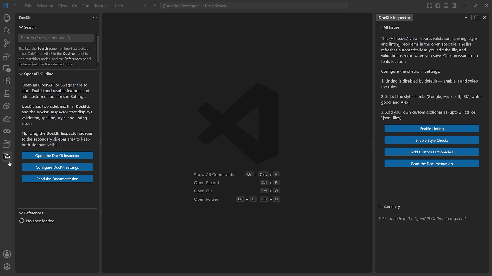

# Installation & Workspace Setup

## Requirements

* **Visual Studio Code:** Version `1.118.0` or later.
* **Supported Files:** OpenAPI 3.1.x, 3.0.x, or Swagger 2.0 in `.json`, `.jsonc`, `.yaml`, or `.yml` format.
* **Runtime:** No external runtimes (Node.js/Python) or cloud accounts required. All processing runs locally in the extension host.

## Installation

### From VS Code Marketplace

1. Open VS Code and navigate to the Extensions view (`Ctrl+Shift+X` / `Cmd+Shift+X`).
2. Search for `DocKit` or `dockit.oas-docs`.
3. Select **DocKit: OpenAPI Documentation Toolkit** and click **Install**.

### From the Command Line

```bash
code --install-extension dockit.oas-docs
```

<figure><figcaption></figcaption></figure>
